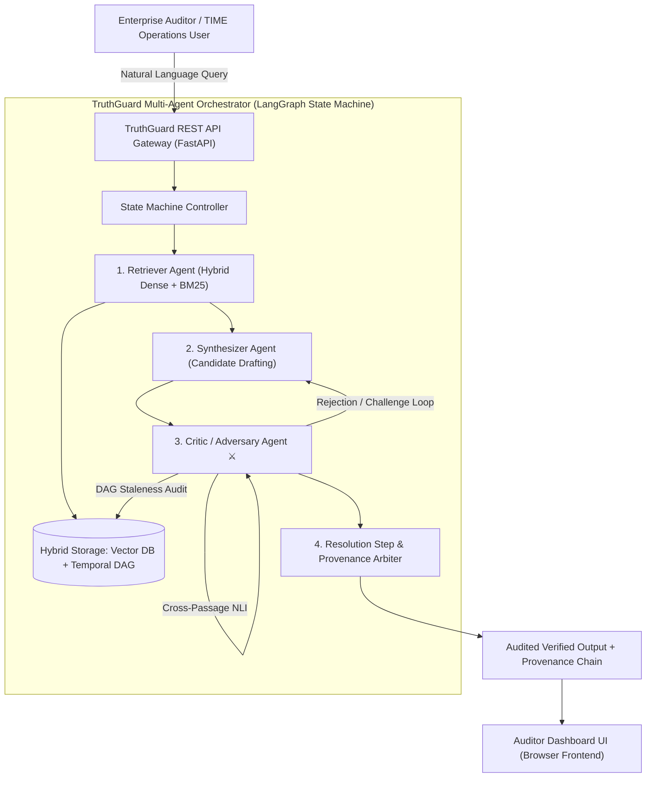

# TruthGuard: Architecture Design Document
### Virtusa Jatayu Season 6 | Track: TIME BU | Theme: Forward Deployment Engineer
**Team Name:** CodeBots (Batch 2027)  
**Authors:** Team CodeBots (Lead Architect, Agent Engineer, Vector DB Specialist, Evaluator, Cloud Deployer)  
**Document Version:** 2.0 (Stage 2 Architecture Baseline)

---

## 1. Executive Summary & Problem Formulation
Enterprise knowledge corpora (specifically in regulated industries such as Telecom, Healthcare, and BFSI) are inherently inconsistent. Version sprawl, post-contract addenda, regulatory amendments, and deprecation circulars create contradictory assertions across internal repositories.

Standard Retrieval-Augmented Generation (RAG) paradigms suffer from three fatal enterprise failure modes:
1. **Hallucinated False Compromises:** The language model attempts to smooth over irreconcilable assertions by inventing a middle-ground compromise.
2. **Staleness Blindness:** Dense semantic embeddings reward semantic similarity regardless of whether a passage is 5 years out of date.
3. **Absence of Provenance:** Answers are emitted without an audit trail demonstrating why source A was prioritized over source B.

**TruthGuard** solves this via a dialectical multi-agent architecture coupled with a **Temporal Knowledge Graph (TKG)**. By decoupling retrieval, synthesis, adversarial cross-examination, and temporal resolution into specialized autonomous agents, TruthGuard eliminates hallucinations and transparently enforces provenance.

---

## 2. System Architecture (C4 Model)

---

## 3. Detailed Component Specifications

### 3.1. Retriever Agent
* **Ingestion Pipeline:** Chunks documents into semantic sections and extracts metadata headers:
  * `id`: Unique document code (e.g., `DOC-TIME-001`).
  * `version`: Semantic version string (`v1.0`, `v2.1`).
  * `effective_date`: ISO-8601 timestamp (`YYYY-MM-DD`).
  * `supersedes` / `superseded_by`: Explicit parent-child lineage pointers.
* **Hybrid Search Strategy:** Combines BM25 lexical search (k1=1.5, b=0.75) for exact section numbers, currency amounts, and metric units, with dense vector cosine similarity for conceptual recall.

### 3.2. Synthesizer Agent
* **Role:** Acts as the primary answering engine. Formulates an initial hypothesis strictly based on candidate passages and extracts factual assertions (monetary caps, timeframes, wattages, dosages).
* **Claim-Passage Binding:** Binds each quantitative assertion to its source passage index to prepare for adversarial cross-examination.

### 3.3. Critic / Adversary Agent (The Dialectical Engine)
The Critic operates in three adversarial passes:
1. **Contradiction Cross-Check:** Pairwise compares all retrieved passages using metric-extraction and Natural Language Inference (NLI). If Document A states `$5,000` and Document B states `$25,000`, a high-severity contradiction alert is raised.
2. **Temporal Staleness Audit:** Traverses the Temporal DAG. If a cited passage has an outbound `superseded_by` edge, the Critic marks the passage as `SUPERSEDED_DEPRECATED`.
3. **Unsupported Claim Audit:** Scans candidate draft assertions; if any claim is ungrounded in the retrieved text, it is flagged as a potential hallucination.

### 3.4. Resolution Step & Provenance Arbiter
* **Case A: Resolvable via Temporal Precedence:** When conflicting documents form a directed path in the Temporal DAG (`Parent ➔ Superseding Child`), the Arbiter crowns the newer document as canonical and surfaces both positions with explicit timestamps:
  > *"CANONICAL CURRENT POLICY (Effective 2025-03-01): Tier-1 Outage penalty is capped at $25,000 (DOC-TIME-002), superseding prior $5,000 cap from DOC-TIME-001."*
* **Case B: Unresolvable Ambiguity:** When conflicting documents share concurrent effective dates without a hierarchy (e.g. Regional vs. Federal circulars), the Arbiter refuses to synthesize false consensus. It transparently presents both positions with confidence capped at 50% and flags the query for manual compliance escalation.

---

## 4. Cryptographic Provenance Ledger
Every response emitted by TruthGuard contains an immutable provenance chain calculated via:
$$\text{Hash} = \text{SHA-256}(\text{DocID} \parallel \text{EffectiveDate} \parallel \text{PassageContent})[0:16]$$

This hash guarantees that auditors can verify historical records against corporate document management systems (DMS) without tampering.

---

## 5. Security, RBAC & Deployment Architecture
* **Access Control:** Role-Based Access Control (RBAC) separating `Auditor (Read-Only)` from `Knowledge Admin (Ingest/Amend)`.
* **Containerization:** Modular Docker containers orchestrating the FastAPI backend and static web server.
* **Scalability:** Deployed on Kubernetes (EKS/AKS) with horizontal pod autoscaling and Redis caching for sub-2.5s response latency.
