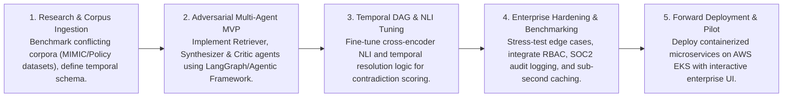
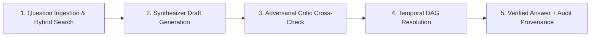

# Virtusa Jatayu Season 6: Complete Strategy & Slide Solution Blueprint

---

## 1. Competition Executive Summary & Rules

| Attribute | Details |
| :--- | :--- |
| **Competition** | Virtusa Jatayu Season 6 (Open Talent Ideathon) |
| **Theme** | **Forward Deployment Engineer (FDE)** — *Innovate. Engineer. Deploy.* |
| **Target Cohort** | 2027 Pass-out Batch (IT, CSE, ECE, Data Science, AI/ML, Cyber Security) |
| **Team Size** | 3 to 5 students per team (Strict rule: Dropping below 3 = disqualification) |
| **Timeline** | September 2026 – February 2027 (Stage 1: 2 wks, Stage 2: 4 wks, Stage 3: 8 wks) |
| **Stage 1 Deliverable** | **1-slide solution PPT (strictly max 1–2 slides)** using the official template |
| **Submission Naming** | `Team Name_Use Case` (e.g., `AlphaSquad_TruthGuard.pptx`) |
| **Disqualification Rule** | Teams creating their own use cases will be disqualified immediately. |
| **Awards** | 🥇 **$1,000 USD** + Full-time Job Opportunity at Virtusa<br>🥈 **$750 USD** + Full-time Job Opportunity at Virtusa |

---

## 2. Stage-by-Stage Progression Plan

```mermaid
graph TD
    A["Stage 1: Problem Detailing (2 Weeks)"] -->|College Faculty selects Top 2 Teams| B["Stage 2: Solution Building (4 Weeks)"]
    B -->|POC Demo + Arch Doc + 20m Pitch / 10m Q&A| C["Virtusa shortlists Top 4 Teams per BU"]
    C -->|Stage 3: Industrialization (8 Weeks)| D["Virtual Internship + Mentor Connects"]
    D -->|Final Code + Video + Video Pitch| E["Grand Finale: 1 Winner & 1 Runner-Up per BU"]
```

### Key Milestones:
1. **Stage 1 (Problem Detailing - 2 Weeks):** 
   - Choose one provided use case.
   - Craft a high-density, 1-to-2 slide PPT aligning with Virtusa's template.
   - Internal College Evaluation: Faculty mentors select top 2 teams per institute.
2. **Stage 2 (Solution Building - 4 Weeks):**
   - Build working Proof of Concept (POC) and Architecture Document.
   - Weekly 60-minute Virtusa mentor connects.
   - 20-min pitch + 10-min live Q&A. Top 4 teams per BU selected.
3. **Stage 3 (Industrialization - 8 Weeks):**
   - Virtual internship and enterprise-grade deployment.
   - Working model video demo + GitHub repo + credentials.

---

## 3. Use Case Deep Dive & Evaluation (TIME Business Unit)

Virtusa's **TIME** (Telecom, Information, Media & Entertainment) Business Unit provided two high-impact problem statements:

### Use Case 1: `TruthGuard — Adversarial Verification for Multi-Agent Document Q&A` *(Highest Recommended)*
* **The Problem:** Enterprise RAG and Document Q&A systems fail catastrophically when corporate corpora contain conflicting SOPs, outdated policies, contradicting FAQs, and superseded amendments. Traditional LLMs "hallucinate" blended, falsely confident answers that expose companies to regulatory liability.
* **The Virtusa Mandate:** Build a multi-agent system containing:
  1. **Retriever Agent:** Hybrid dense-sparse retrieval from corpus.
  2. **Synthesizer Agent:** Drafts candidate answers from retrieved passages.
  3. **Critic / Adversary Agent:** Actively tries to break the synthesizer (checks direct contradictions, checks document staleness/timestamp metadata, flags unsupported claims).
  4. **Resolution Engine:** Surfaces both conflicting positions with provenance (e.g. *"Policy v1 states X; superseded by March 2025 amendment Y"*) or explicitly admits indeterminacy.
* **Why it Wins:** Cutting-edge agentic workflow, directly aligns with the "Forward Deployment Engineer" theme, and solves the #1 unsolved challenge in enterprise GenAI.

---

### Use Case 2: `Field-to-Record: Voice-to-Structured Clinical Note Generator`
* **The Problem:** First responders (paramedics, EMTs) dictate chaotic, high-stress on-scene notes. Unstructured dictations cause billing errors, compliance failures, and patient handoff disasters.
* **The Virtusa Mandate:**
  1. Speech/Text input → Local Named Entity Recognition (NER) for Drug, Dosage, Route, Procedure.
  2. Structured JSON / FHIR-lite standard compliance.
  3. Human-readable clinical document generation.
  4. **Edge AI / 100% Offline Mode:** Zero reliance on cloud connectivity in disaster zones or transit.
  5. Privacy-first: Trained and evaluated on de-identified clinical corpora (MIMIC-III, n2c2).
* **Why it Wins:** Massive social impact, rugged edge computing architecture (ONNX / Whisper-tiny / local SLM), and healthcare compliance.

---

## 4. Complete Slide Blueprint: Use Case 1 (TruthGuard)

Following the exact 2-slide structure demonstrated by winning teams (such as *LicenceToScript*):

### 📄 SLIDE 1: Problem, Market Need, Value Proposition & Roadmap

#### Top Header & Overview
* **Title:** **TruthGuard: Adversarial Multi-Agent Verification for Contradictory Enterprise Corpora**
* **Problem Statement:** Modern enterprise document corpora are rife with version divergence, deprecated guidelines, and superseded amendments. Standard RAG architectures blindly synthesize contradictory evidence into hallucinated, compromise answers. TruthGuard deploys an adversarial multi-agent debate and temporal resolution protocol to detect contradictions, enforce provenance, and guarantee zero-hallucination document Q&A.

#### Section 1: Business Need & Strategic Opportunity
* **Dialectical Agentic Debate:** Separates retrieval, synthesis, and adversarial cross-examination into specialized autonomous agents.
* **Temporal Provenance & Graph Ordering:** Constructs a document version DAG (Directed Acyclic Graph) to automatically prioritize newer amendments and track policy evolution.
* **Entailment & Contradiction Verification:** Natural Language Inference (NLI) classifiers cross-examine retrieved passages to catch conflicting directives before synthesis.
* **Verifiable Provenance Attestation:** Every assertion is mathematically linked to cryptographic passage hashes, eliminating hallucinated enterprise liability.
* **Transparent Ambiguity Resolution:** Outputs dual-perspective audit logs when information cannot be reconciled deterministically.

#### Section 2: Target Segment
* **Legal & Corporate Compliance:** Contract amendment tracking and multi-jurisdiction regulatory auditing.
* **Healthcare & Life Sciences:** Conflicting clinical trial protocols, drug dosage updates, and treatment guidelines.
* **BFSI & Fintech:** Ever-changing compliance circulars, KYC updates, and insurance policy clauses.
* **Telecom & Media (Virtusa TIME):** Multi-tier service contracts, SLA amendments, and evolving network SOPs.

#### Section 3: Market Size & Growth
* **Market Trend:** The Enterprise Agentic AI & RAG Verification Market is expanding from **$5.3B (2024)** to **$38.7B (2032)**.
* **CAGR:** **31.8% CAGR (2025–2032)** *(Gartner & Grand View Research)*.
* **Urgency:** Over **74% of enterprise RAG failures** in 2025 were traced to stale or conflicting internal documents.

#### Section 4: Future Readiness (5-Phase Delivery Roadmap)


#### Section 5: Team Box & Glossary
* **Team Details:** Team Name: `[Your Team Name]` | Members: `[Member 1, Member 2, Member 3, Member 4, Member 5]`
* **Glossary:** *RAG: Retrieval-Augmented Generation; NLI: Natural Language Inference; DAG: Directed Acyclic Graph; SLM: Small Language Model; RBAC: Role-Based Access Control; Provenance: Origin and chronological custody of information.*

---

### 📄 SLIDE 2: Solution Architecture, USP, POC Flow & Diagrams

#### Section 1: Solution Details
* **Zero-Hallucination Pipeline:** Decoupled synthesis and adversarial cross-examination eliminates confident factual errors.
* **Temporal Version Resolution:** Exploits document timestamps and amendment hierarchies to determine canonical truths.
* **Audit-Chain Explainability:** Every response provides a dual-column provenance view explaining *why* document A superseded document B.
* **Production-Grade Microservices:** Containerized modular microservices built for Kubernetes (EKS) and on-premises deployment.

#### Section 2: Unique Selling Proposition (USP - 4 Pillars)
| Pillar | Title | Technical Details |
| :--- | :--- | :--- |
| **01** | **Adversarial Critic Agent** | Uses bidirectional cross-attention NLI and claim-level verification to aggressively invalidate unsupported or stale assertions. |
| **02** | **Temporal Graph Provenance** | Dynamically constructs a Temporal Knowledge Graph (TKG) linking parent policies with child amendments, circulars, and revocations. |
| **03** | **Transparent Dissent Engine** | Rather than silencing conflicts, it surfaces explicit comparative matrices (*"Policy 2023 v1 vs Directive 2025 v2"*). |
| **04** | **Forward-Deployment Ready** | API-first design with LangGraph orchestration, OpenTelemetry tracing, and sub-2.5s end-to-end response latency. |

#### Section 3: Proof of Concept (POC) Flow


#### Section 4: System Architecture Diagram
```
+-----------------------------------------------------------------------------------+
|                            TRUTHGUARD ARCHITECTURE                                |
+-----------------------------------------------------------------------------------+
|  [ Enterprise User / Compliance Auditor ]                                         |
|                         │ Query                                                   |
|                         ▼                                                         |
|  +─────────────────────────────────────────────────────────────────────────────+  |
|  | Multi-Agent Orchestrator (LangGraph / State Machine Engine)                 |  |
|  +─────────────────────────────────────────────────────────────────────────────+  |
|       │                                                               ▲           |
|       ▼                                                               │           |
|  +─────────────────+         +──────────────────────────+             │           |
|  | RETRIEVER AGENT | ──────> | Dense + BM25 Vector DB   |             │           |
|  +─────────────────+         | (Milvus / Qdrant)        |             │           |
|       │ (Candidate Passages) +──────────────────────────+             │ Feedback  |
|       ▼                                                               │ Loop      |
|  +───────────────────+                                                │           |
|  | SYNTHESIZER AGENT | ──> Drafts Candidate Response                  │           |
|  +───────────────────+            │                                   │           |
|                                   ▼                                   │           |
|                      +───────────────────────────+                    │           |
|                      | CRITIC / ADVERSARY AGENT  | ───────────────────┘           |
|                      | • Contradiction Detector  |                                |
|                      | • Temporal Staleness Flag |                                |
|                      | • Unsupported Claim Audit |                                |
|                      +───────────────────────────+                                |
|                                   │                                               |
|                                   ▼ Verified Passages / Conflict Detected         |
|                      +───────────────────────────+                                |
|                      | RESOLUTION ENGINE         |                                |
|                      | • Surface Dissenting View |                                |
|                      | • Apply Superseding Rule  |                                |
|                      +───────────────────────────+                                |
|                                   │                                               |
|                                   ▼ Final Output                                  |
|  [ Transparent Structured Response + Provenance Citations + Confidence Matrix ]   |
+-----------------------------------------------------------------------------------+
```

---

## 5. Complete Slide Blueprint: Use Case 2 (Field-to-Record)

### 📄 SLIDE 1: Problem, Market, Value Proposition & Roadmap
* **Title:** **Field-to-Record: Offline Edge-AI Clinical Note Generator & Audit Trail**
* **Problem Statement:** First responders administer critical medications and life-saving interventions in austere, connectivity-denied environments. Paper scratchpads and delayed post-incident dictations lead to 30%+ clinical documentation omissions and audit failures. Field-to-Record runs 100% offline on edge devices to convert unstructured voice dictations into timestamped, FHIR-compliant clinical records.
* **Business Opportunity:** Zero-connectivity Edge Whisper ASR + Quantized Clinical NER (BioBERT/BioClincal-SLM) + Automated HL7 FHIR-lite JSON serialization.
* **Target Segment:** Emergency Medical Services (EMS), Disaster Response & Defense Medic Units, Rural Ambulatory Transport, Hospital Trauma Ingestion.
* **Market Size:** EMS & Healthcare Documentation Market reaching **$14.8B by 2031** at **24.5% CAGR**.
* **5-Phase Roadmap:** 1. Clinical Corpus Ingestion (MIMIC-III/n2c2) -> 2. Edge ASR & Quantized NER Model -> 3. FHIR-lite Schema Generator & UI -> 4. Field Validation & Rugged Edge Benchmark -> 5. Fleet Deployment & Hospital EHR Integration.

### 📄 SLIDE 2: Architecture, USP, POC Flow & Diagrams
* **USP 1 (100% Offline Edge Runtime):** Local ONNX Runtime speech-to-text without cloud roundtrip latency.
* **USP 2 (Clinical NER for Emergency Regimens):** Extraction of Drug, Dosage, Unit, Administration Route, and Timestamp.
* **USP 3 (FHIR-lite Audit Chain):** Structured HL7 FHIR `MedicationAdministration` and `Procedure` resource formatting.
* **USP 4 (Tamper-Evident Sign-off):** SHA-256 local ledger guaranteeing chronological audit compliance.
* **POC Flow:** Voice Dictation -> Local ASR (Whisper-Edge) -> Clinical NER & Entity Normalization (RxNorm/SNOMED) -> FHIR JSON Builder -> Human-Readable Clinical Handover Note.
